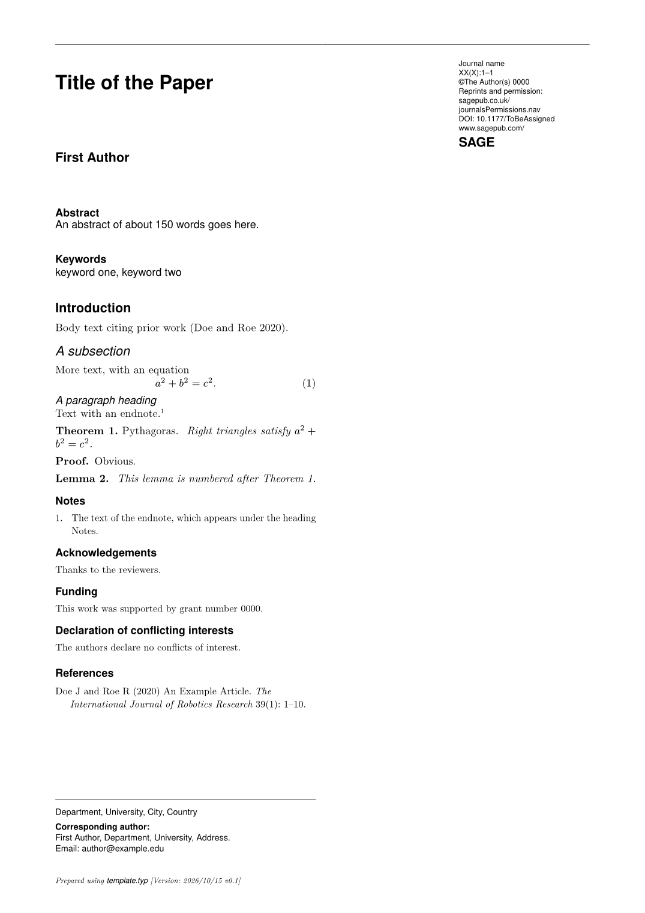
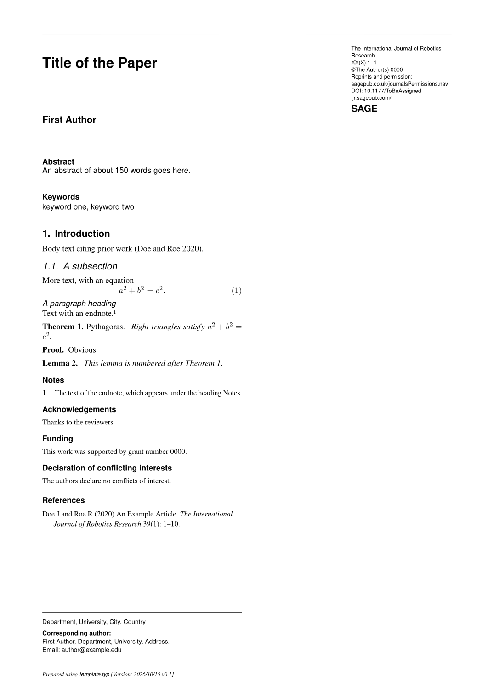

# Typst SAGE journal template

This repository contains a SAGE journal template for Typst papers.
`template.typ` reproduces the layout of SAGE's `sagej.cls` v1.01, which is the common styling across all SAGE journals.
The class's options are arguments to `paper`.

## Examples

`example.typ` uses the class's defaults: A4 two-column pages, Computer Modern, unnumbered sections, Harvard references and placeholder journal details.
Start from it for a SAGE journal that has no file of its own here.

```sh
typst compile example.typ
```



`ijrr.typ` configures the template for the International Journal of Robotics Research.
It is equivalent to `\documentclass[Afour,sageh,times]{sagej}` with sections numbered as IJRR prints them: `times: true`, `numbering: "1.1."`, and IJRR's name and web address in `journal`.
Fill in `volume`, `issue`, `year` and `doi` from the acceptance notice.

```sh
typst compile ijrr.typ
```



To set up another journal, copy `ijrr.typ` and change the `paper.with(...)` arguments described below.

## Arguments of `paper`

| Argument                                                  | Values                                                                                                                                                             | sagej.cls equivalent                 |
| --------------------------------------------------------- | ------------------------------------------------------------------------------------------------------------------------------------------------------------------ | ------------------------------------ |
| `layout`                                                  | `"Afour"` (default), `"shortAfour"`, `"MCfour"`, `"PCfour"` (two column); `"Royal"`, `"Crown"` (single column); or a dictionary `(paper:, text:, columns:, sans:)` | the size options                     |
| `times`                                                   | `false` (default, Computer Modern) or `true` (Times and Helvetica at 0.95)                                                                                         | `times`                              |
| `doublespace`                                             | `false` or `true` (1.25 times line spacing)                                                                                                                        | `doublespace`                        |
| `citations`                                               | `"harvard"` (default), `"vancouver"`, `"apa"`; sets the look of the reference list                                                                                 | `sageh`, `sagev`, `sageapa`          |
| `numbering`                                               | `none` (default, the class leaves sections unnumbered) or a pattern such as `"1.1."`                                                                               | `secnumdepth`                        |
| `journal`                                                 | dictionary with `name`, `volume`, `issue`, `year`, `doi`, `permissions`, `url`, `logo`; omitted keys keep the placeholders in `journal-defaults`                   | `\journalname`, `\volumenumber`, ... |
| `fonts`                                                   | dictionary with `serif`, `sans`, `mono`                                                                                                                            |                                      |
| `version` | the version of this template shown on the first page's footer; defaults to `template-version` | `\update` |
| `title`, `short-title`, `authors`, `abstract`, `keywords` | as in `example.typ`                                                                                                                                                | `\title`, `\runninghead`, ...        |

`PCfour` sets the title block and captions in the serif face, as the class does.

`citations` does not choose a bibliography style file.
Pair it with `style:` in `#bibliography`: `"sage-harvard.csl"` (included) for `"harvard"`, `"nlm-citation-sequence"` (Typst's built-in Vancouver style) for `"vancouver"`, and `"apa"` for `"apa"`.

## Other exports

`affiliation-note(affiliation, corresponding)` places the unmarked footnotes on the first page.
`acknowledgements`, `funding`, `supplemental-material`, `conflicting-interests`, `author-biography` and `author-biographies` set the class's back-matter sections.
`sf(size, body)` sets sans-serif text and `runin(body)` a run-in heading; both work inside the body.

## Theorems and proofs

The class sets theorems in a bold head with the name, number and a period, followed by an italic body.
It defines no environments, so each paper makes its own with `theorem-env`:

```typ
#let theorem = theorem-env("Theorem")
#let lemma = theorem-env("Lemma", kind: "theorem")
#let remark = theorem-env("Remark", numbered: false)

#theorem(note: [Pythagoras])[Right triangles satisfy $a^2 + b^2 = c^2$.] <thm:pythagoras>
#proof[Obvious.]
```

Environments with the same `kind` share a counter, as `\newtheorem{lemma}[theorem]{Lemma}` does.
The kind defaults to the lowercased name.
A label after the environment makes `@thm:pythagoras` print "Theorem 1".
`proof(body, name: [Proof])` sets a proof with a bold head and no end mark, as the class does.

## Endnotes

`endnote[...]` leaves a superscript number in the text and records the note.
`print-endnotes()` sets all recorded notes at the reference size, with the numbers in a 15 pt hanging margin, under the heading "Notes".
`print-endnotes(title: [...])` changes the heading.
Call it once, where the notes belong, usually before the acknowledgements.

## Fonts

With `times: true` the template needs Nimbus Roman, Nimbus Sans and Nimbus Mono PS.
Without it, text is New Computer Modern.
Typst has no bundled Computer Modern sans-serif or typewriter face, so those fall back to Nimbus Sans and Nimbus Mono PS unless `fonts:` names others, such as `fonts: (sans: "CMU Sans Serif", mono: "CMU Typewriter Text")`.

## Not covered

The class's footnote marks, which are symbols rather than numbers.
The journal logo is the text "SAGE" unless `journal.logo` holds an image.
